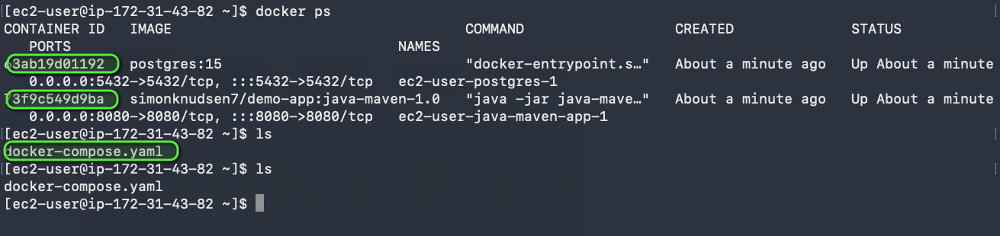
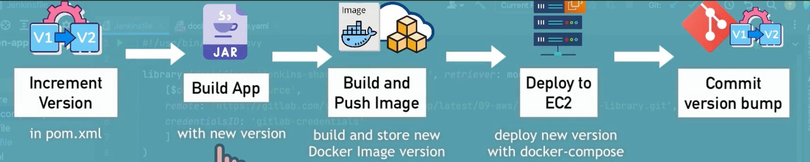

# CD - Deploy Application from Jenkins Pipeline to EC2 Instance (automatically with docker)

 

## Technologies used:

AWS, Jenkins, Docker, Linux, Git, Java, Maven, Docker Hub

 

## Project Description:

- Prepare AWS EC2 Instance for deployment (Install Docker)
- Create ssh key credentials for EC2 server on Jenkins
- Extend the previous CI pipeline with deploy step to ssh into the remote EC2 instance and deploy newly built image from Jenkins server
- Configure security group on EC2 Instance to allow access to our web application

 

 
_Overview of the complete CI/CD pipeline I built: run tests, build the JAR, build the Docker image, push it to my private Docker Hub repo and deploy it to AWS EC2._

 

 
_Successful run of my Jenkins multibranch pipeline, with all stages passing, including the new deploy stage that connects to the EC2 instance over SSH._

 

 
_On the EC2 instance, `docker images` shows that the `simonknudsen7/demo-app:1.0` image was pulled from Docker Hub by the pipeline._

 

 
_The deployed application running in the browser on the EC2 instance's public IP, reachable after I opened the port in the security group._

 

# CD - Deploy Application from Jenkins Pipeline on EC2 Instance (automatically with docker-compose)

 

## Technologies used:

AWS, Jenkins, Docker, Linux, Git, Java, Maven, Docker Hub

 

## Project Description:

- Installed Docker Compose on the AWS EC2 instance
- Created a `docker-compose.yaml` file that deploys the web application image together with a PostgreSQL database
- Configured the Jenkins pipeline to copy the compose file to the EC2 server and deploy the newly built image with Docker Compose
- Improvement: moved the Linux commands that run on the remote server into a separate shell script, which the Jenkinsfile copies to the EC2 instance and executes

 

 
_On the EC2 instance, `ls` shows the `docker-compose.yaml` file that the Jenkins pipeline copied to the server, and `docker ps` shows the two containers Docker Compose started from it: `simonknudsen7/demo-app:java-maven-1.0` on port 8080 and `postgres:15` on port 5432._

 

# Complete the CI/CD Pipeline (Docker-Compose, Dynamic versioning)

 

## Technologies used:

AWS, Jenkins, Docker, Linux, Git, Java, Maven, Docker Hub

 

## Project Description:

- CI step: Increment version
- CI step: Build artifact for Java Maven application
- CI step: Build and push Docker image to Docker Hub
- CD step: Deploy new application version with Docker Compose
- CD step: Commit the version update

 

 
_Overview of the complete CI/CD pipeline I built with dynamic versioning: Jenkins increments the version in `pom.xml`, builds the JAR with the new version, builds and pushes a Docker image tagged with that version to Docker Hub, deploys it to EC2 with Docker Compose, and finally commits the version bump back to the Git repository._

 
